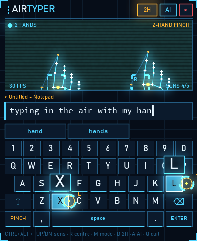
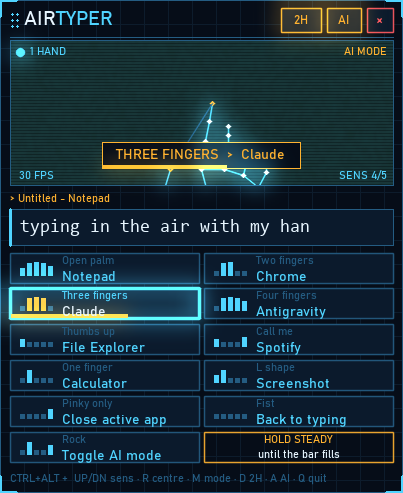

# AirTyper

Type in the air with your webcam, and open apps with hand gestures. AirTyper runs as a small always-on-top HUD that never takes focus, so everything it types goes into the window you last clicked.

<p>
  
  
</p>

Built with [MediaPipe Hands](https://ai.google.dev/edge/mediapipe/solutions/vision/hand_landmarker), OpenCV and pynput. Windows only.

## Install

Requires Windows 10/11, a webcam, and [Python 3.10](https://www.python.org/downloads/) (with the `py` launcher).

```bat
git clone https://github.com/josephalwin175-ai/airtyper.git
cd airtyper
setup.bat
```

`setup.bat` creates a virtual environment, installs the dependencies, downloads the hand-tracking model, and adds **AirTyper** shortcuts to your Desktop and Start menu.

## Start it

- Double-click **AirTyper** on your Desktop or search for it in the Start menu.
- Problems? Run `run-debug.bat` to see messages, or check `airtyper.log`.

## Typing

1. Click the window you want to type into (Notepad, browser, chat...).
2. Raise your hand. The cursor starts in the middle of the keyboard, wherever your hand is.
3. Move your hand a little to steer. Pinch thumb + index to press the highlighted key.

- **1H / 2H** button: one-hand or two-hand typing. In 2H, your left hand covers the left half of the keyboard and your right hand the right half.
- **Suggestions**: pinch a word above the keyboard to finish it.
- **Hybrid**: your real keyboard works at the same time. Hand typing pauses for about a second after real keystrokes, so resting hands can't press keys.
- **MODE key**: switch between pinch and dwell (hover 0.7 s to press).

## AI mode (gestures)

Turn it on with the **AI** button, `Ctrl+Alt+A`, or by holding the rock gesture. Hold a gesture steady until the bar fills (about 1.6 s).

| Gesture | Fingers up | Action |
|---|---|---|
| Open palm | all five | Notepad |
| Two fingers | index, middle | Chrome |
| Three fingers | index, middle, ring | Claude |
| Four fingers | all but thumb | Antigravity |
| Thumbs up | thumb, pointing up | File Explorer |
| Call me | thumb, pinky | Spotify |
| One finger | index | Calculator |
| L shape | thumb, index | Screenshot (Win+Shift+S) |
| Pinky only | pinky | Close the active app (2.4 s hold) |
| Fist | none | Back to typing |
| Rock | index, pinky | Turn AI mode on/off (works while typing) |

Change the apps in `gestures.json`. Each entry has a `name` and either a `run` (a program path, a URL, or a `shell:AppsFolder\...` ID) or `keys` (for example `"ctrl+shift+t"`). Restart AirTyper after editing.

## Window and hotkeys

Drag the header to move the window; the position is remembered. The **×** button closes AirTyper.

| Ctrl+Alt + | |
|---|---|
| Up / Down | more / less sensitive |
| R | re-centre the cursor on your hand |
| M | pinch / dwell |
| D | one / two hands |
| A | AI mode |
| H | hide / show |
| Q | quit |

## Tuning

The constants at the top of `airtyper.py` control the feel: `SENS_LEVELS` (movement range), `PINCH_ON` / `PINCH_OFF` (pinch sensitivity), `GESTURE_HOLD` (gesture hold time), `EASE` (cursor smoothness).

## Files

| File | Purpose |
|---|---|
| `airtyper.py` | the app |
| `gestures.json` | gesture → app mapping |
| `settings.json` | saved window position, sensitivity, mode |
| `assets/airtyper.ico` | app icon (regenerate with `make_icon.py`) |
| `models/hand_landmarker.task` | MediaPipe hand-tracking model |
| `setup.bat`, `create_shortcuts.ps1` | install and shortcut creation |
| `run-debug.bat` | run with a console for troubleshooting |
| `airtyper-concept.html` | original design concept |

## License

MIT. See [LICENSE](LICENSE).
